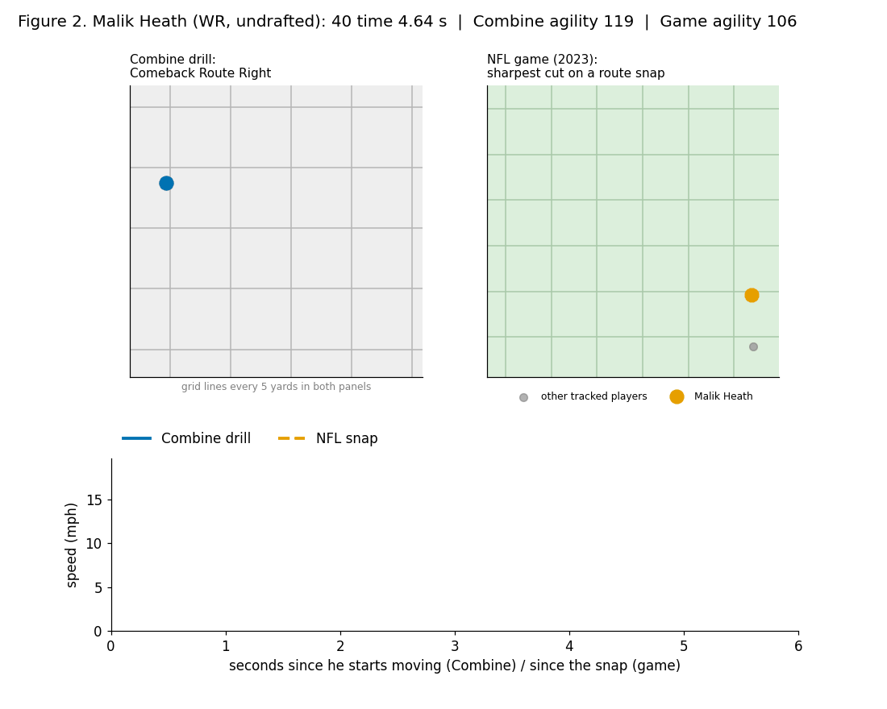
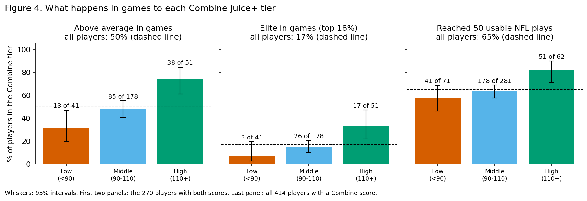

# Juice+: Measuring Juice from the Combine to NFL. Games.

Scouts say a player has **juice** when he has an extra gear others don't. The Combine is mocked as the "Underwear Olympics," with its critics saying it can't tell you who can *play*. For this reason, we strictly ask:

> **Can the Combine tell us who will have "juice" in an NFL game before they step foot on the field?**

**Juice+** answers with one score, measured with the same tracking chips, in the same units, at the Combine and in games.

*Everything here comes from one run of [Juice+_work.ipynb](Juice+_work.ipynb) on the competition data. Appendix A of the notebook recomputes every number quoted below.*

### How to read the numbers

| Term | Unit and meaning |
|---|---|
| **Juice+** | Measured in points. 100 = average at his position after removing body size. 10 points = 1 standard deviation (SD). 110 = better than about 84% of his position. |
| **ρ (rho)** | Spearman rank correlation, from −1 to +1. 0 = no link, +1 = identical rankings. |
| **Partial ρ** | The same, after holding another measure fixed (usually the 40-yard dash). It shows what a measure adds *beyond* that one. |
| **[a, b]** | 95% confidence interval. If both ends are above 0, the link is unlikely to be chance. |
| **"Elite in games"** | Game Juice+ in the top 16% at his position (about 110+ points). |

---

## Key findings for a front office

The sample is 270 rookies from the 2023 to 2025 draft classes with both a Combine and a game score.

1. **Use Juice+ as a red flag and a green flag, not a ranking.** Only **3 of 41 players (7%)** with Juice+ under 90 at the Combine became elite movers in games. **17 of 51 (33%)** players with a Juice+ of 110 or more at the Combine were also elite in games, more than double the **15%** rate of players between 90 and 110. Inside that middle tier the score barely orders players (ρ = 0.10).
2. **Most stars had juice.** **8 of 9** Pro Bowl or All-Pro players had a Juice+ over 100 at the Combine, Brian Branch being the one under with 98 at the Combine and 113 in games.
3. **Find late-round athletes the board misses.** Late-round picks at 110+ points finished in the top half of game movement **5 of 6 times**, against **36%** for other late picks.
4. **Juice+ spots agile players the stopwatch misses.** Its tracked agility predicts how hard WR and DB cut in games, even among players with the same 40 time (partial ρ = **+0.33**).
5. **Juice+ flags who will grow in year 2.** WR and DB whose Juice+ tracked agility outran their rookie play improved by **+0.71 SD** in year 2, while everyone else slipped **−0.48 SD**.

## 1. What Juice+ measures

Juice+ borrows from baseball's "plus" stats, like OPS+: compare a player with peers at his position, remove context that isn't ability (**body size and draft class**), and report one number where 100 is average.

It has three components. **Combine Juice+** and **Game Juice+** build them the same way, from the same tracking chips, in the same units, so a player's Combine score and his game score compare like with like.

| Component | Combine Juice+ | Game Juice+ |
|---|---|---|
| **Top speed** | Fastest 10-yard stretch of the 40 (mph) | Peak speed on his best plays (mph) |
| **Burst** | Time (s) and average acceleration (yd/s²) from yard 2 to yard 10 of the 40 | The same yard 2 to 10 split (s) and acceleration (yd/s²), timed from where he stood at the snap |
| **Agility** | Pace (yd/s) and braking (yd/s²) through his position drills | Hardest sideways acceleration on his best plays (yd/s²) |

Agility counts only where a group's drills agree with each other (DL, OL, DB, WR). EDGE and TE Juice+ is top speed and burst only.

**How the number is built.** Each component starts from a tracked measure $x$ (say, top speed in mph) and goes through three steps, always within the player's position group $p$:

1. **Remove size and draft class.** Predict $x$ from weight, weight², height and draft class, using every *other* player at his position, and standardize what is left over:

   $$z_i = \frac{e_i - \bar{e}_p}{s_p}, \qquad e_i = x_i - \hat{x}_i$$

   where $\hat{x}_i$ is his predicted value and $\bar{e}_p$, $s_p$ are the mean and SD of the leftovers at his position. Burst averages two of these (the split, flipped so faster is higher, and acceleration). Agility averages pace and braking across his drills.
2. **Pull thin samples toward average.** With $k_i$ reps (40 attempts, drills or game plays) and $r$, how well one rep agrees with another:

   $$C_i = z_i \cdot \frac{k_i\,r}{1 + (k_i - 1)\,r}$$

   A player with many reps keeps nearly all of $z_i$. One with few is pulled toward 0, the position average.
3. **Combine the components on the 100 scale.**

   $$\text{Juice+}_i = 100 + 10 \cdot \frac{\bar{C}_i - m_p}{\sigma_p}, \qquad \bar{C}_i = w_s C^{\text{speed}}_i + w_b C^{\text{burst}}_i + w_a C^{\text{agility}}_i$$

   where $m_p$ and $\sigma_p$ are the mean and SD of $\bar{C}$ at his position, so both scores average 100 with an SD of 10. The weights are equal at the Combine. In games they follow how repeatable each component is (0.36, 0.31, 0.34). Without agility (EDGE, TE), the other two weights are rescaled to sum to 1.

**Narrower scores in the same style.** Juice+ is meant as one all-around measure of how a player moves, but any single component can be scored the same way. **Agility+** is the agility component on its own after steps 1 and 2, put on the same 100 scale: 100 is average for his position and size, and higher means more agile. Speed+ and Burst+ work the same way, so a team can see how a player's juice is built, not just how much he has.

**Why remove size.** Among defensive linemen, weight and raw top speed have ρ = −0.70. After the size adjustment, ρ = +0.15 (Figure 1). Overall, Juice+ has almost no link to weight (ρ = −0.04).

Juice+ puts a player's explosiveness in the context of his size and position. In nearly every case, a 165-pound receiver will be faster, quicker and more agile than a 265-pound edge rusher, but that says more about size than about athleticism. Juice+ measures how well an athlete moves compared with players of similar size at his position. For example, T'Vondre Sweat, a 366-pound nose tackle, ran a 5.27 s 40, the slowest of any 2024 defensive lineman in the data. For his size, though, he has a 110 Combine Juice+ and a 106 Game Juice+. Teams that want raw speed regardless of size should use the 40.

## 2. Game Juice+: the same components, measured on Sundays

Game Juice+ is built using the same three components tracked in the combine from every 2023 to 2025 regular-season snap:

- **Like is compared with like, and best efforts count.** Each play is compared only with plays at the same position, alignment, route and length, and each component uses a player's 95th-percentile play. Very short snaps and snaps in decided games are dropped.
- **Burst starts from his spot, not the snap.** Timing yards 2 to 10 from where he stood keeps reaction time out, just like the 40.
- **A player needs 50 usable plays.** 320 players qualify.

Game movement is stable for each component: random halves of a player's plays agree at r = 0.94 (top speed), 0.89 (agility) and 0.81 (burst).

**Figure 2:** Malik Heath (WR, undrafted, 2023; Combine Juice+ 98, Game Juice+ 104) ran a **4.64 s** 40, in the bottom 5% of receivers, but his Combine Agility+ was **119**. Over **229 NFL plays** his Game Agility+ was **108**: his sharpest route drill (left), his sharpest NFL cut (right), and both speed traces on one clock (bottom).

## 3. Does Combine juice show up in games?

**Yes, on average.** Across the 270 players with both scores, Combine and Game Juice+ have **ρ = 0.30** [0.18, 0.40]. That is modest: Juice+ won't rank players one by one, but it sorts them into groups that move differently on Sundays.

In points, a player's Game Juice+ lands within 10 points (1 SD) of his Combine Juice+ **60%** of the time, with an average gap of **9.3 points**. Pairing each player with a random game score from his own position gives 52% and 11.4 points, so the two scores line up, but loosely.

The link holds when the formula is built without each player's own draft class (ρ = 0.29), for part-timers with 50 to 199 plays (0.20) and for starters with 600+ plays (0.21). It is strongest where games ask players to run in space: DB (0.47), TE (0.44, only 20 players), WR (0.30) and EDGE (0.29). It is weakest on the lines: OL (0.16) and interior DL (0.08).

For a draft room, tiers are the useful view (Figure 4). Juice+ also shows who gets on the field: **82%** of players at 110+ logged 50 usable NFL plays, against **58%** of players under 90.

## 4. The stars had juice: every Pro Bowl and All-Pro player

Juice+ measures movement, not skill, so ask one way: **do the best players have juice?** They do. **8 of 9** Pro Bowl or All-Pro players with a Combine score were above 100 points, against 50% of all scored players, and **5 of 9** were at 110+, against 15% of all players. The reverse is not true: 208 players scored above 100 points, and only 8 earned those honors.

| Player | Pos | Pick | Honors | Combine Juice+ | Game Juice+ |
|---|---|---|---|---|---|
| Byron Young | OLB | 77 | Pro Bowl | 121 | 118 |
| Chimere Dike | WR | 103 | All-Pro, Pro Bowl | 118 | 115 |
| Darnell Wright | T | 10 | All-Pro (2nd team) | 115 | 114 |
| Quinyon Mitchell | CB | 22 | All-Pro, Pro Bowl | 113 | 84 |
| Joe Alt | T | 5 | Pro Bowl | 112 | 93 |
| Jared Verse | OLB | 19 | Pro Bowl x2 | 103 | 83 |
| Marvin Mims | WR | 63 | All-Pro, Pro Bowl x2 | 102 | 105 |
| Will Anderson | DE | 3 | All-Pro, Pro Bowl | 101 | 92 |
| Brian Branch | SS | 45 | Pro Bowl | 98 | 113 |

Branch, the one exception, scored 98 at the Combine and moved well in games (113). Puka Nacua (Game Juice+ 86), Jaxon Smith-Njigba (104) and Tuli Tuipulotu (88) have no Combine score.

## 5. Why Juice+ instead of the 40 or the NGS Athleticism Score

The 40 and the NGS Athleticism Score grade a prospect at the Combine and stop there. Juice+ is built to be followed onto the field.

**What the NGS Athleticism Score is.** Next Gen Stats grades draft prospects from 50 to 99, a scale that reads like a Madden rating. Its athleticism score turns Combine drill results into a grade using position-specific models trained on every draft class since 2003. Players who skip drills get an estimate. Size and college production are graded separately.

*We leave out RAS (Relative Athletic Score). We don't have the official RAS numbers or its exact formula, and didn't want to misrepresent it in a comparison.*

| | Juice+ | 40 | NGS Athleticism |
|---|---|---|---|
| One scale at the Combine and in games | Yes | No | No |
| What it measures | Speed, burst and agility, from tracking | Sprint time | Combine drill results, including jumps, through a model |

**Top 5 at the Combine by each score**, among the 414 players with a Combine Juice+. Juice+ is in points (100 = position average), and NGS runs from 50 to 99. Four players tie for 3rd on NGS, so its list has six. A dash means no Game Juice+ (under 50 usable plays).

| Player | Top 5 by | Combine Juice+ | Game Juice+ | NGS |
|---|---|---|---|---|
| Brian Thomas (WR, 209 lb) | Juice+ #1 | 134 | 104 | 93 |
| Adetomiwa Adebawore (DT, 282 lb) | Juice+ #2 | 133 | 110 | 90 |
| Darien Porter (CB, 195 lb) | Juice+ #3, NGS T-3 | 131 | 113 | 97 |
| Mason McCormick (G, 309 lb) | Juice+ #4 | 123 | 90 | 86 |
| Maxwell Hairston (CB, 183 lb) | Juice+ #5 | 123 | 120 | 86 |
| Tate Ratledge (G, 308 lb) | NGS #1 | 108 | 92 | 99 |
| Deonte Banks (CB, 197 lb) | NGS #2 | 106 | 90 | 98 |
| Tanor Bortolini (C, 303 lb) | NGS T-3 | 114 | 107 | 97 |
| Zack Kuntz (TE, 255 lb) | NGS T-3 | 115 | — | 97 |
| Jared Wilson (G, 310 lb) | NGS T-3 | 117 | 106 | 97 |

Only Darien Porter makes both lists: the scores measure different things. Because Juice+ has a game version, its list can also be checked on Sundays.

1. **It can be checked against the player's own games.** Combine and Game Juice+ are built the same way from the same tracking data and put on the same scale (100 = position average), so a team can see whether a prospect's Combine movement showed up on Sundays and keep following him every season. The two scores won't match exactly: top speed and burst are measured the same way in both places, but agility comes from drills at the Combine and from sideways acceleration in games. Section 3 shows how closely they line up. A 40 time or an NGS model score has no game-day version, so it can never be checked against the player it graded.
2. **It reads how a player moves, not just when he finishes.** A stopwatch gives one time per drill. Juice+ reads speed and braking all the way through it, which picks up change of direction. For WR and DB, Juice+ agility predicts how hard they cut in games even among players with the same 40 time (partial ρ = **+0.33** [0.15, 0.49], 125 players).
3. **It measures only juice.** Juice+ is speed, burst and agility: how a player moves. NGS also counts the jumping drills, so a high NGS score can come from leaping instead of movement.

## 6. Limits

- **Movement, not production.** Once size is removed, no athleticism score (ours, NGS or the 40) predicts separation, pressure or coverage EPA well (all between ρ = 0.00 and +0.08).
- **Small samples, weak on the lines.** Position groups have 20 to 64 players, and OL and interior DL movement barely carries into games (ρ = 0.16 and 0.08).
- **Six position groups only.** The Combine tracking has almost no quarterbacks, running backs or linebackers, so Juice+ covers OL, DL, EDGE, DB, WR and TE. Agility counts for four of them.
- **No tracked 40, no score.** Top speed and burst both come from the 40, so 91 of the 505 players with Combine tracking have no Combine Juice+.
- **Only players who play get a game score.** 108 of the 505 never logged a regular-season snap, and Game Juice+ needs 50 usable plays. The link to games is measured on players who earned the field, so it can't say whether the rest had juice that never got a chance.
- **Early career only.** Game Juice+ covers at most three seasons (one for the 2025 class), so it can't yet say how juice holds up as players age.
