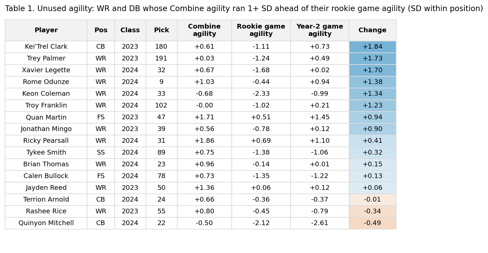

# Juice+: Does Combine Movement Show Up on Sundays?

Scouts say a player has **juice** when he has an extra gear others don't. The Combine is mocked as the "Underwear Olympics," with its critics saying it can't tell you who can *play*. For this reason, we strictly ask:

> **Do players who move like elite athletes at the Combine also move like elite athletes in NFL games?**

**Juice+** answers with one score, measured with the same tracking chips, in the same units, at the Combine and in games.

*Everything here comes from one run of [Juice+_work.ipynb](Juice+_work.ipynb) on the competition data. Appendix A of the notebook recomputes every number quoted below.*

### How to read the numbers

| Term | Unit and meaning |
|---|---|
| **Juice+** | Measured in points. 100 = average at his position after removing body size. 10 points = 1 standard deviation (SD). 110 = better than about 84% of his position. |
| **ρ (rho)** | Spearman rank correlation, from −1 to +1. 0 = no link, +1 = identical rankings. |
| **Partial ρ** | The same, after holding another measure fixed (usually the 40-yard dash). It shows what a measure adds *beyond* that one. |
| **[a, b]** | 95% confidence interval. If both ends are above 0, the link is unlikely to be chance. |
| **"Elite in games"** | Game Juice+ in the top 16% at his position (about 110+ points). |

---

## Key findings for a front office

The sample is 270 rookies from the 2023 to 2025 draft classes with both a Combine and a game score.

1. **Use Juice+ as a red flag and a green flag, not a ranking.** Only **1 of 39 players (3%)** with Juice+ under 90 at the Combine became elite movers in games. **20 of 61 (33%)** players with a Juice+ of 110 or more at the Combine were also elite in games, more than double the **15%** rate of players between 90 and 110. Inside that middle tier the score barely orders players (ρ = 0.07).
2. **Most stars had juice.** **8 of 9** Pro Bowl or All-Pro players had a Juice+ over 100 at the Combine, Brian Branch being the one under with 95 at the Combine and 107 in games.
3. **Find late-round athletes the board misses.** Late-round picks at 110+ points finished in the top half of game movement **4 of 7 times (57%)**, against **37%** for other late picks.
4. **Juice+ spots agile players a stopwatch can't.** The tracking data component of Juice+ measures agility that stopwatch measuring cannot. Agility tracking predicts how hard WR and DB cut in games, even among players with the same 40 time (partial ρ = **+0.33**).
5. **Juice+ flags who will grow in year 2.** WR and DB whose Juice+ agility outran their rookie play improved by **+0.71 SD** in year 2, while everyone else slipped **−0.48 SD**.

## 1. What Juice+ measures

Juice+ borrows from baseball's OPS+: compare a player with peers at his position, remove context that isn't ability (**body size and draft class**), and report one number where 100 is average.

It has three pieces, measured the same way at the Combine and in games wherever possible. **Combine Juice+** blends tracking with the official stopwatch tests (Section 2 explains why). **Game Juice+** is tracking only.

| Piece | Everything in Combine Juice+ | Everything in Game Juice+ |
|---|---|---|
| **Top speed** | **Tracking:** fastest 10-yard stretch of the 40 (mph) **Stopwatch:** 40-yard dash (s) | **Tracking:** peak speed on his best plays (mph) |
| **Burst** | **Tracking:** time (s) and average acceleration (yd/s²) from yard 2 to yard 10 of the 40 **Stopwatch:** 10-yard split (s), vertical (in), broad jump (in) | **Tracking:** the same yard 2 to 10 split (s) and acceleration (yd/s²), timed from where he stood at the snap |
| **Agility** | **Tracking:** pace (yd/s) and braking (yd/s²) through his position drills **Stopwatch:** 3-cone (s), short shuttle (s) | **Tracking:** hardest sideways acceleration on his best plays (yd/s²) |

Agility counts only where a group's drills agree with each other (DL, OL, DB, WR). EDGE and TE Juice+ is top speed and burst only.

**Why remove size.** Among defensive linemen, weight and raw top speed have ρ = −0.70. After the size adjustment, ρ = +0.15 (Figure 1). Overall, Juice+ has almost no link to weight (ρ = −0.03), while the 40 (ρ = −0.34) and a RAS-style score (ρ = −0.29) partly reward being light.

## 2. Why Combine tracking is blended with the stopwatch

The Combine gives little tracking per player: usually **2 attempts** at the 40 and a few position drills, so one bad or great rep moves the score a lot. Between a player's two 40 attempts, tracked top speed repeats well (r = 0.91, on a 0 to 1 scale) but burst does not (r = 0.67).

So we pull noisy pieces toward average (more so for players with fewer reps), then average each tracked piece 50/50 with the stopwatch tests of the same trait.

We expected the blend to tighten the link to games. It didn't change it. On the same 270 players, within position, tracked-only Combine Juice+ correlates with Game Juice+ at **ρ = 0.30** and the blended score at **ρ = 0.29** (difference −0.01 [−0.05, +0.03]). We keep the blend because it costs nothing and ties Juice+ to the official times teams already trust. The tracked-only result also shows that **tracking on its own carries over to games**.

## 3. Game Juice+: the same pieces, measured on Sundays

Game Juice+ rebuilds the same three pieces from every 2023 to 2025 regular-season snap:

- **Like is compared with like, and best efforts count.** Each play is compared only with plays at the same position, alignment, route and length, and each piece uses a player's 95th-percentile play. Very short snaps and snaps in decided games are dropped.
- **Burst starts from his spot, not the snap.** Timing yards 2 to 10 from where he stood keeps reaction time out, just like the 40.
- **A player needs 50 usable plays.** 320 players qualify.

Game movement is stable: random halves of a player's plays agree at r = 0.94 (top speed), 0.89 (agility) and 0.81 (burst).

**Figure 2:** Malik Heath (WR, undrafted, 2023) ran a **4.64 s** 40, in the bottom 5% of receivers, but his drill agility was **119 points**. Over **229 NFL plays** his game agility was **106 points**: his sharpest route drill (left), his sharpest NFL cut (right), and both speed traces on one clock (bottom).

## 4. Does Combine juice show up in games?

**Yes, on average.** Across the 270 players with both scores, Combine and Game Juice+ have **ρ = 0.28** [0.17, 0.39]. That is modest: Juice+ won't rank players one by one, but it sorts them into groups that move differently on Sundays.

The link holds when the formula is built without each player's own draft class (ρ = 0.27), for part-timers with 50 to 199 plays (0.26) and for starters with 600+ plays (0.21). It is strongest where games ask players to run in space: TE (0.53, only 20 players), DB (0.41), EDGE (0.35) and WR (0.28). It is weakest on the lines: OL (0.12) and interior DL (0.10). Position groups have 20 to 64 players, so these intervals are wide.

For a draft room, tiers are the useful view (Figure 4).

## 5. Juice+ picks up agility

A 40 time can't measure **change of direction**. Juice+ can, because its agility piece reads speed and braking inside each position's drills.

For WR and DB (Figure 5), Juice+ agility predicts game agility at partial ρ = **+0.33** [0.15, 0.49] (n = 125 players), even among players with the same 40 time. It holds at +0.33 to +0.35 after also accounting for draft pick, play count or size (shuffle test p < 0.001). Across every group with agility, the piece improves Juice+'s prediction of overall Game Juice+ (partial ρ = +0.17 [0.05, 0.30]).

**It also predicts growth.** Holding a player's rookie game agility fixed, his Juice+ agility still predicts his year-2 game agility (partial ρ = **+0.34** [0.12, 0.54], n = 63 players). Table 1 lists the 16 WR and DB whose Combine agility ran 1+ SD ahead of their rookie play (year-2 change: **+0.71 SD**, vs. **−0.48 SD** for everyone else).

## 6. The stars had juice: every Pro Bowl and All-Pro player

Juice+ measures movement, not skill, so ask one way: **do the best players have juice?** They do. **8 of 9** Pro Bowl or All-Pro players with a Combine score were above 100 points, against 50% of all scored players, and **5 of 9** were at 110+, against 17% of all players. The reverse is not true: 205 players scored above 100 points, and only 8 earned those honors.

| Player | Pos | Pick | Honors | Combine Juice+ | Game Juice+ |
|---|---|---|---|---|---|
| Byron Young | OLB | 77 | Pro Bowl | 121 | 111 |
| Chimere Dike | WR | 103 | All-Pro, Pro Bowl | 116 | 109 |
| Darnell Wright | T | 10 | All-Pro (2nd team) | 113 | 108 |
| Quinyon Mitchell | CB | 22 | All-Pro, Pro Bowl | 113 | 92 |
| Joe Alt | T | 5 | Pro Bowl | 112 | 96 |
| Marvin Mims | WR | 63 | All-Pro, Pro Bowl x2 | 106 | 103 |
| Jared Verse | OLB | 19 | Pro Bowl x2 | 105 | 90 |
| Will Anderson | DE | 3 | All-Pro, Pro Bowl | 103 | 96 |
| Brian Branch | SS | 45 | Pro Bowl | 95 | 107 |

The one exception, Brian Branch, still moved well in games (107 points). Puka Nacua, Jaxon Smith-Njigba and Tuli Tuipulotu have no Combine score.

## 7. Aren't we grading our own homework?

A fair objection: Game Juice+ is also our metric, so the link could be built in. We don't think it is.

**The claim is narrow.** Not that Juice+ is the best predictor of Game Juice+, but that, on average, players who move well at the Combine move well in games, and Juice+ captures agility a stopwatch can't.

**Game Juice+ is a direct measurement, not a model of the Combine.** It is speed (mph), burst (s) and sideways acceleration (yd/s²) from game tracking. No Combine number enters it, and it is stable on its own (split-half r = 0.81 to 0.94).

**Scores we didn't build also predict it.** On the same 249 players:

| Combine score | ρ with Game Juice+ |
|---|---|
| Official 40, size-adjusted | 0.29 |
| Juice+ | 0.27 |
| Official 40, plain | 0.24 |
| NGS Athleticism Score | 0.16 |
| RAS-style score | 0.14 |

The plain 40 ranks game movement nearly as well, so Game Juice+ captures what football people already call athleticism. Juice+ does lead NGS (by +0.11 [0.02, 0.20]) and RAS-style (by +0.13 [0.05, 0.23]), but this table is a sanity check, not the headline.

**It connects to outcomes nobody built:** reaching the field (88% of players at 110+ logged 50 usable plays vs. 57% under 90), Pro Bowls (Section 6), and for receivers, separation and a small gain in points (Figure 7).

## 8. Why Juice+ instead of RAS or the NGS Athleticism Score

1. **Same units at the Combine and in games.** Juice+ measures speed in mph and acceleration in yd/s² with the same chips in both places, so a prospect's Combine number can be checked against his own game number. RAS (a percentile of drill times) and NGS (a model score) have no game-day version.
2. **It sees change of direction.** Juice+ reads speed and braking inside each position's drills, and for WR and DB that carries into game cutting (Section 5).
3. **It doesn't reward being light** (ρ with weight: −0.03, vs. −0.29 for RAS-style and −0.34 for the 40).

## 9. Limits

- **Movement, not production.** Once size is removed, no athleticism score (ours, NGS, RAS-style or the 40) predicts separation, pressure or coverage EPA well (all near ρ = +0.03 to +0.08).
- **The agility link is not settled.** For WR and DB it holds in 2023 (partial ρ = +0.40) and 2024 (+0.35), but is weaker in 2025 (+0.15).
- **Small samples, weak on the lines.** Position groups have 20 to 64 players, and OL and interior DL movement barely carries into games (ρ = 0.12 and 0.10).

**Next:** score our 2026 receiver predictions, made before the season, once it ends.
