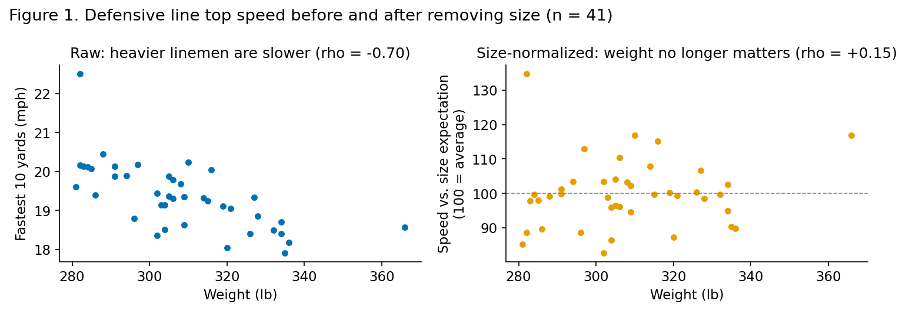
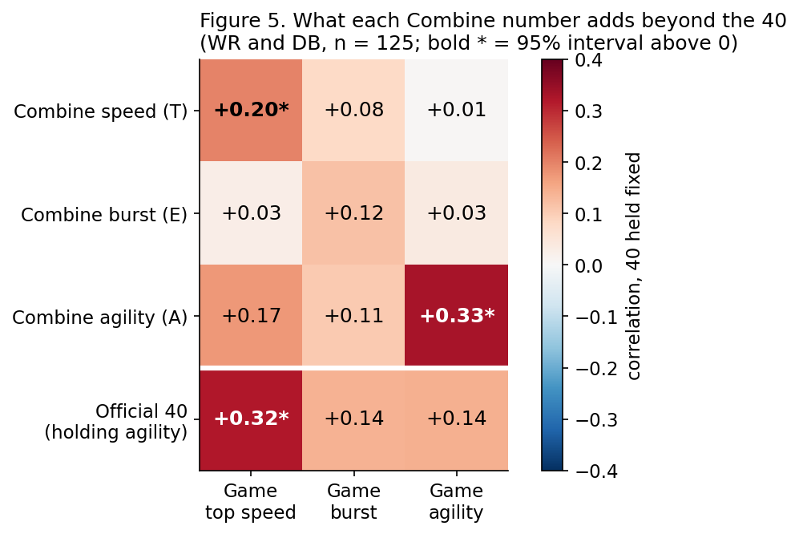
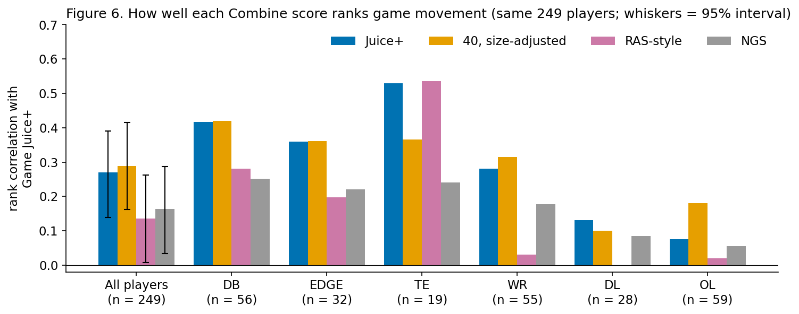
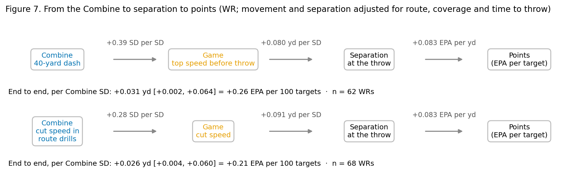

# Juice+: Finding the Extra Gear in the "Underwear Olympics"

Scouts say a player has **juice** when he has an extra gear the players around him don't. It's the receiver who runs past a corner who had him covered, or the safety who closes on a ball that looked out of reach. It's the movement that **pops off the screen**.

The Combine is often mocked as the **"Underwear Olympics"**. Prospects run and jump in shorts, with no pads and no opponent, so many evaluators doubt the drills say much about football. We agree they don't tell you who can *play*. We ask a narrower question a front office can act on:

> **If a team wants to add juice to its roster, does the way a prospect moves in Combine drills show up in how he moves in NFL games? And what can tracking see that a stopwatch can't?**

**Juice+** answers with one number, built from the Combine's 10 Hz tracking and rebuilt the same way from NFL game tracking.

**Key findings (270 rookies with both scores, 2023 to 2025 draft classes):**
- **Combine juice shows up on Sundays.** Players at 110+ became elite movers in games **33%** of the time. Under 90, only **1 of 39** did.
- **For speed, the stopwatch already knows.** Juice+ ties a size-adjusted 40 on game movement and clearly beats NGS and RAS.
- **Agility is what the 40 misses.** For receivers and defensive backs, tracked drill agility predicts how hard a player cuts in games even after his 40 is known (**+0.33**).
- **Agility predicts growth.** Receivers and DBs whose drill agility ran ahead of their rookie play improved in year 2. The 40 predicted none of it.

*All the work is in [Juice+_work.ipynb](Juice+_work.ipynb). It runs the full pipeline on the competition data, draws every figure and table here, and rechecks every number quoted.*

## 1. What Juice+ measures

Juice+ borrows from baseball's **OPS+**. Compare a player with his peers, remove context that isn't ability, and report one number where **100 is average**. Here the peers are players at the same position, and the context removed is **body size and draft class**. **Every 10 points is one standard deviation**, so 110 means one standard deviation better than the average player at his position.

It has three pieces, each measured with the same tracking chips at the Combine and in games:

| Piece | Combine Juice+ (tracking) | Game Juice+ | Stopwatch tests averaged in |
|---|---|---|---|
| **Top speed** (the extra gear) | Fastest 10-yard stretch of the 40 | Peak speed on his best plays | 40 time |
| **Burst** (first step) | Time and acceleration from yard 2 to yard 10 of the 40 | The same split, timed from where he stood at the snap | 10-yard split, vertical, broad jump |
| **Agility** (change of direction) | Pace and braking through his position drills | Hardest sideways acceleration on his best plays | 3-cone, shuttle |

Speed and burst are timed the same way in both places. Agility is not. At the Combine it is drill pace, and in games it is how hard a player actually cuts. So when one predicts the other, two different measurements agree, not one formula counted twice.

## 2. Building Juice+

**Data.** Every 2023 to 2025 rookie with Combine tracking in WR, TE, DB, OL, interior DL and EDGE: 505 players, 414 with every piece.

1. **Top speed and burst** come from the tracked 40, the one drill with the same layout for everyone. Top speed repeats almost perfectly between a player's two attempts (0.91 on a 0 to 1 scale) and matches the official 40 at 0.89. Burst is noisier (0.67).
2. **Agility** comes from each position's drills (bag, route and back-pedal drills) plus the 3-cone and shuttle. It only counts where a group's drills agree with each other. DL, OL, DB and WR pass. EDGE and TE don't, so their Juice+ is speed and burst only.
3. **Size and class are removed.** Within each group, a leave-one-out regression predicts each piece from weight, weight², height and draft class. Juice+ keeps what's left over. A 330-pound guard who moves like a 300-pound guard grades out *positive*.
4. **Noisy pieces are pulled toward average**, then **each tracked piece is averaged 50/50 with the stopwatch tests of the same trait**, since two imperfect measures cancel some noise. The pieces are averaged and put on the 100 scale.

Without step 3, tracked speed is mostly a scale reading. Among defensive linemen, weight and raw top speed have a rank correlation of -0.70 (0 means no link). After the adjustment it is +0.15 (Figure 1). Overall, Juice+ has almost no link to weight (-0.03), while the 40 (-0.34) and a RAS-style score (-0.29) partly reward being light.

## 3. Seeing juice translate

**Game Juice+** rebuilds the same pieces from every 2023 to 2025 regular-season snap:
- **Like is compared with like.** Each play is compared only with plays at the same position, alignment, route and length. Very short snaps and snaps in decided games are dropped.
- **Best efforts count.** Each piece uses a player's 95th-percentile play, so loafing snaps don't drag him down.
- **Burst starts from his spot, not the snap.** Timing yards 2 to 10 from where he stood keeps reaction time out, just like the 40.
- **A player needs 50 usable plays.** The pieces are weighted by how well they repeat. 320 players qualify.

Game movement is a stable trait: split a player's plays in half at random and the halves agree at 0.94 (top speed), 0.89 (agility) and 0.81 (burst).

Figure 2 shows what translation looks like. **Malik Heath** (WR, undrafted, 2023) ran a 4.64 40, in the bottom 5% of receivers. His overall Combine Juice+ was 91, so a 40-first board passes on him. But his drill agility was 119, among the best of any receiver, and in 229 NFL plays his game agility came in above average at 106. Left: his sharpest route drill. Right: his sharpest cut on an NFL route. Bottom: both speed traces on one clock.

## 4. Does Combine juice show up in games?

**Yes.** Across the 270 players with both scores, the rank correlation between Combine and Game Juice+ is **0.28** (95% interval 0.17 to 0.39). A formula built without each player's own draft class gives the same answer (0.27). It holds for part-timers (50 to 199 plays: 0.26) and starters (600+: 0.21). It is strongest for defensive backs (0.41), edge rushers (0.35), tight ends (0.53, only 20 players) and receivers (0.28), and weakest for the lines (OL 0.12, interior DL 0.10), where games rarely ask big men to run in space.

The more useful view for a draft room is by tier (Figure 4):
- **Red flag:** only 1 of 39 players under 90 became an elite mover in games (top 16% at his position).
- **Green flag:** 20 of 61 players at 110+ did (33%), more than double the 15% in the middle tier.
- **Reaching the field:** 88% of players at 110+ logged 50 usable NFL plays, against 57% of players under 90.

Inside the 90 to 110 tier, the score barely orders players (0.07). So read Juice+ as three tiers, not a ranking.

**Which piece carries beyond the 40?** Figure 5 asks each Combine number to predict each game trait for receivers and defensive backs, with the 40 held fixed. A number that only repeats the stopwatch goes blank. Drill agility lights up its own trait: **+0.33** (0.15 to 0.49). Tracked speed adds a little to game top speed (+0.20). Burst adds nothing yet. The 40 itself predicts game top speed (+0.32) but not game agility. The stopwatch can't see change of direction.

## 5. Juice+ vs. the stopwatch

On the same 249 players, Combine Juice+ ranks game movement at **0.27**. The NGS Athleticism Score reaches 0.16 and a RAS-style score 0.14 (Figure 6). Both gaps are clear (+0.11 and +0.13, with intervals above 0).

The 40 is the real benchmark. The plain 40 reaches 0.24. Take body size out of it and it reaches 0.29, level with Juice+. For straight-line speed, nothing beats a stopwatch. Juice+'s value is the part a stopwatch can't time:

- **Agility beyond the 40.** For WR and DB, drill agility predicts game agility with the 40 held fixed at **+0.33** (n = 125). It stays at +0.33 to +0.35 when RAS-style, draft pick, play count or body size are also held fixed. Shuffling agility scores within each position never comes close (p < 0.001). Across all groups with agility, it adds +0.17 (0.05 to 0.30) to overall Game Juice+.
- **It isn't who got on the field.** WR and DB who never reached 50 plays had the same Combine agility as those who did (49th vs. 51st percentile).
- **It predicts growth.** Holding a player's rookie game agility fixed, his Combine agility still predicts his year-2 game agility: **+0.34** (0.12 to 0.54, n = 63). The 40 in the same model: **+0.01**. The 16 WR and DB whose drill agility ran a full standard deviation (SD) ahead of their rookie play gained 0.71 SD the next year. Everyone else slipped 0.48 SD.

## 6. Using Juice+ to add juice to a roster

Teams already pay for juice somewhat (first-round picks average 107, undrafted players 94), but the draft prices the whole player and leaves athletes on the board. A team can use Juice+ three ways:

1. **Draft-board filter.** Flag prospects at 110+ and red-flag those under 90. Juice+ says who has the gear. Scouts decide whether he can play. Late-round players at 110+ finished in the top half of game movement 4 of 7 times (other late picks: 37%), including Eric Watts (DE), Will Mallory (TE) and Marques Sigle (SS).
2. **The agility flag for WR and DB.** A receiver or corner whose drill agility is far ahead of his 40 is the prospect a stopwatch board misses, like Heath. Use it to sort a tier, not to call one player: in matched pairs with the same 40, the more agile player moved better in games only 53% of the time.
3. **Week to week, and year to year.** For top speed, a rookie's first 10 plays already beat his Combine, but the Combine keeps adding (+0.07 R² even after 100 plays). For agility, game film wins right away. So in season, trust the film for agility. Across seasons, trust the Combine: a rookie whose drill agility outran his game agility is a candidate to grow in year 2 (Table 1).

**Does juice show up in results?** A little, and the stars had it. Of the 9 All-Pro or Pro Bowl players with a Combine score, 8 were above 100 (all scored players: 50%). Moving well also buys a receiver separation, and each yard of separation at the throw is worth +0.083 EPA per target. Figure 7 follows the chain for WRs: the Combine predicts game movement, and game movement predicts separation. End to end, one SD at the Combine is worth about 0.03 yards of separation, or 0.2 to 0.3 EPA per 100 targets. Real, but small.

## 7. Limits and next steps

- **Movement, not production.** Juice+ says how a player moves next to same-position, same-size peers. On results like separation, pressure and coverage EPA, no athleticism score (ours, NGS, RAS-style or the 40) predicts well once size is removed (all near +0.03 to +0.08).
- **Agility is strong but not settled.** For WR and DB it holds in the 2023 (+0.40) and 2024 (+0.35) classes, but the 2025 class alone is weaker (+0.15). Head to head with the 40 for game agility, agility leads, but not by a clear margin.
- **Small samples.** 20 to 64 players per position, so position-level intervals are wide.
- **Linemen.** OL and interior DL movement barely carries into games.
- **Scope.** Regular season only. Game tracking covers only this rookie group.

**Next:** score our 2026 receiver predictions, made before the season, once it ends.

*All numbers come from one run of the code on the competition data. The code for every figure and table is in [Juice+_work.ipynb](Juice+_work.ipynb).*
