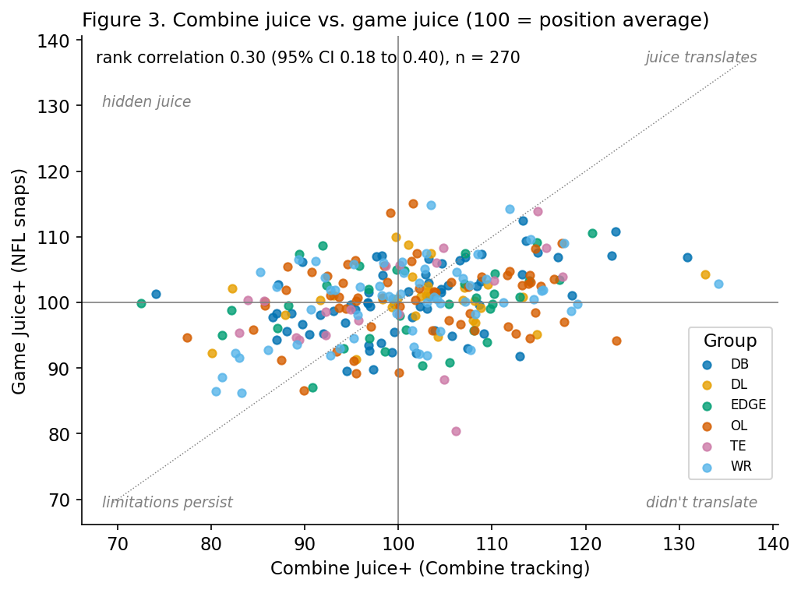

# Juice+: Does Combine Movement Show Up on Sundays?

Scouts say a player has **juice** when he has an extra gear others don't. The Combine is mocked as the "Underwear Olympics," with its critics saying it can't tell you who can *play*. For this reason, we strictly ask:

> **Do players who move like elite athletes at the Combine also move like elite athletes in NFL games?**

**Juice+** answers with one score, measured with the same tracking chips, in the same units, at the Combine and in games.

*Everything here comes from one run of [Juice+_work.ipynb](Juice+_work.ipynb) on the competition data. Appendix A of the notebook recomputes every number quoted below.*

### How to read the numbers

| Term | Unit and meaning |
|---|---|
| **Juice+** | Measured in points. 100 = average at his position after removing body size. 10 points = 1 standard deviation (SD). 110 = better than about 84% of his position. |
| **ρ (rho)** | Spearman rank correlation, from −1 to +1. 0 = no link, +1 = identical rankings. |
| **Partial ρ** | The same, after holding another measure fixed (usually the 40-yard dash). It shows what a measure adds *beyond* that one. |
| **[a, b]** | 95% confidence interval. If both ends are above 0, the link is unlikely to be chance. |
| **"Elite in games"** | Game Juice+ in the top 16% at his position (about 110+ points). |

---

## Key findings for a front office

The sample is 270 rookies from the 2023 to 2025 draft classes with both a Combine and a game score.

1. **Use Juice+ as a red flag and a green flag, not a ranking.** Only **3 of 41 players (7%)** with Juice+ under 90 at the Combine became elite movers in games. **17 of 51 (33%)** players with a Juice+ of 110 or more at the Combine were also elite in games, more than double the **15%** rate of players between 90 and 110. Inside that middle tier the score barely orders players (ρ = 0.10).
2. **Most stars had juice.** **8 of 9** Pro Bowl or All-Pro players had a Juice+ over 100 at the Combine, Brian Branch being the one under with 98 at the Combine and 107 in games.
3. **Find late-round athletes the board misses.** Late-round picks at 110+ points finished in the top half of game movement **5 of 6 times**, against **36%** for other late picks.
4. **Juice+ spots agile players the stopwatch misses.** Its tracked agility predicts how hard WR and DB cut in games, even among players with the same 40 time and RAS-style score (partial ρ = **+0.33**).
5. **Juice+ flags who will grow in year 2.** WR and DB whose Juice+ tracked agility outran their rookie play improved by **+0.71 SD** in year 2, while everyone else slipped **−0.48 SD**.

## 1. What Juice+ measures

Juice+ borrows from baseball's OPS+: compare a player with peers at his position, remove context that isn't ability (**body size and draft class**), and report one number where 100 is average.

It has three pieces. **Combine Juice+** and **Game Juice+** build them the same way, from the same tracking chips, in the same units, so a player's Combine score and his game score compare like with like.

| Piece | Combine Juice+ | Game Juice+ |
|---|---|---|
| **Top speed** | Fastest 10-yard stretch of the 40 (mph) | Peak speed on his best plays (mph) |
| **Burst** | Time (s) and average acceleration (yd/s²) from yard 2 to yard 10 of the 40 | The same yard 2 to 10 split (s) and acceleration (yd/s²), timed from where he stood at the snap |
| **Agility** | Pace (yd/s) and braking (yd/s²) through his position drills | Hardest sideways acceleration on his best plays (yd/s²) |

Agility counts only where a group's drills agree with each other (DL, OL, DB, WR). EDGE and TE Juice+ is top speed and burst only.

**Why remove size.** Among defensive linemen, weight and raw top speed have ρ = −0.70. After the size adjustment, ρ = +0.15 (Figure 1). Overall, Juice+ has almost no link to weight (ρ = −0.04).

## 2. Game Juice+: the same pieces, measured on Sundays

Game Juice+ rebuilds the same three pieces from every 2023 to 2025 regular-season snap:

- **Like is compared with like, and best efforts count.** Each play is compared only with plays at the same position, alignment, route and length, and each piece uses a player's 95th-percentile play. Very short snaps and snaps in decided games are dropped.
- **Burst starts from his spot, not the snap.** Timing yards 2 to 10 from where he stood keeps reaction time out, just like the 40.
- **A player needs 50 usable plays.** 320 players qualify.

Game movement is stable: random halves of a player's plays agree at r = 0.94 (top speed), 0.89 (agility) and 0.81 (burst).

**Figure 2:** Malik Heath (WR, undrafted, 2023) ran a **4.64 s** 40, in the bottom 5% of receivers, but his drill agility was **119 points**. Over **229 NFL plays** his game agility was **106 points**: his sharpest route drill (left), his sharpest NFL cut (right), and both speed traces on one clock (bottom).

## 3. Does Combine juice show up in games?

**Yes, on average.** Across the 270 players with both scores, Combine and Game Juice+ have **ρ = 0.30** [0.18, 0.40]. That is modest: Juice+ won't rank players one by one, but it sorts them into groups that move differently on Sundays.

The link holds when the formula is built without each player's own draft class (ρ = 0.29), for part-timers with 50 to 199 plays (0.20) and for starters with 600+ plays (0.21). It is strongest where games ask players to run in space: DB (0.47), TE (0.44, only 20 players), WR (0.30) and EDGE (0.29). It is weakest on the lines: OL (0.16) and interior DL (0.08). Position groups have 20 to 64 players, so these intervals are wide.

For a draft room, tiers are the useful view (Figure 4). Juice+ also shows who gets on the field: **82%** of players at 110+ logged 50 usable NFL plays, against **58%** of players under 90.

## 4. The stars had juice: every Pro Bowl and All-Pro player

Juice+ measures movement, not skill, so ask one way: **do the best players have juice?** They do. **8 of 9** Pro Bowl or All-Pro players with a Combine score were above 100 points, against 50% of all scored players, and **5 of 9** were at 110+, against 15% of all players. The reverse is not true: 208 players scored above 100 points, and only 8 earned those honors.

| Player | Pos | Pick | Honors | Combine Juice+ | Game Juice+ |
|---|---|---|---|---|---|
| Byron Young | OLB | 77 | Pro Bowl | 121 | 111 |
| Chimere Dike | WR | 103 | All-Pro, Pro Bowl | 118 | 109 |
| Darnell Wright | T | 10 | All-Pro (2nd team) | 115 | 108 |
| Quinyon Mitchell | CB | 22 | All-Pro, Pro Bowl | 113 | 92 |
| Joe Alt | T | 5 | Pro Bowl | 112 | 96 |
| Jared Verse | OLB | 19 | Pro Bowl x2 | 103 | 90 |
| Marvin Mims | WR | 63 | All-Pro, Pro Bowl x2 | 102 | 103 |
| Will Anderson | DE | 3 | All-Pro, Pro Bowl | 101 | 96 |
| Brian Branch | SS | 45 | Pro Bowl | 98 | 107 |

Branch, the one exception, moved well in games (107 points). Puka Nacua, Jaxon Smith-Njigba and Tuli Tuipulotu have no Combine score.

## 5. Why Juice+ instead of the 40, RAS or the NGS Athleticism Score

The 40, RAS and the NGS Athleticism Score grade a prospect at the Combine and stop there. Juice+ is built to be followed onto the field.

| | Juice+ | 40 | RAS-style | NGS Athleticism |
|---|---|---|---|---|
| Same score at the Combine and in games | Yes | No | No | No |
| Removes body size (ρ with weight, 0 = none) | Yes (−0.04) | No (−0.34) | No (−0.29) | No (+0.13) |

1. **It can be checked against the player's own games.** Combine and Game Juice+ are the same pieces in the same units, so a team can see whether a prospect's Combine movement showed up on Sundays (Section 3) and keep following him on the same scale every season. A 40 time, a RAS percentile or an NGS model score has no game-day version, so it can never be checked against the player it graded.
2. **It reads how a player moves, not just when he finishes.** A stopwatch gives one time per drill. Juice+ reads speed and braking all the way through it, which picks up change of direction. For WR and DB, Juice+ agility predicts how hard they cut in games even among players with the same 40 time and RAS-style score (partial ρ = **+0.33** [0.15, 0.49], 125 players). WR and DB whose Combine agility ran ahead of their rookie play improved by **+0.71 SD** in year 2, while everyone else slipped **−0.48 SD**.
3. **It doesn't reward being light or heavy.** The 40 and RAS-style partly reward light players, and NGS slightly rewards heavy ones. After the size adjustment, Juice+ compares a heavy defensive lineman and a light one on equal terms (Figure 1).

## 6. Limits

- **Movement, not production.** Once size is removed, no athleticism score (ours, NGS, RAS-style or the 40) predicts separation, pressure or coverage EPA well (all between ρ = 0.00 and +0.08).
- **Small samples, weak on the lines.** Position groups have 20 to 64 players, and OL and interior DL movement barely carries into games (ρ = 0.16 and 0.08).
- **Six position groups only.** The Combine tracking has almost no quarterbacks, running backs or linebackers, so Juice+ covers OL, DL, EDGE, DB, WR and TE. Agility counts for four of them.
- **No tracked 40, no score.** Top speed and burst both come from the 40, so 91 of the 505 players with Combine tracking have no Combine Juice+.
- **Only players who play get a game score.** 108 of the 505 never logged a regular-season snap, and Game Juice+ needs 50 usable plays. The link to games is measured on players who earned the field, so it can't say whether the rest had juice that never got a chance.
- **Early career only.** Game Juice+ covers at most three seasons (one for the 2025 class), so it can't yet say how juice holds up as players age.
